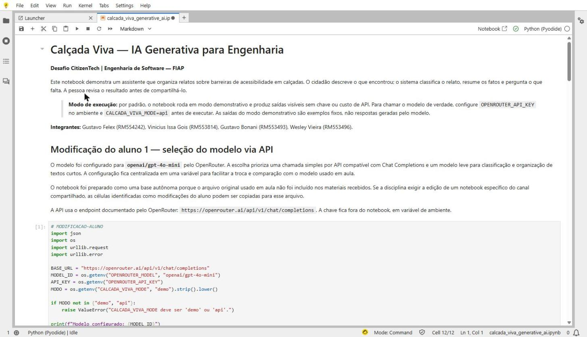
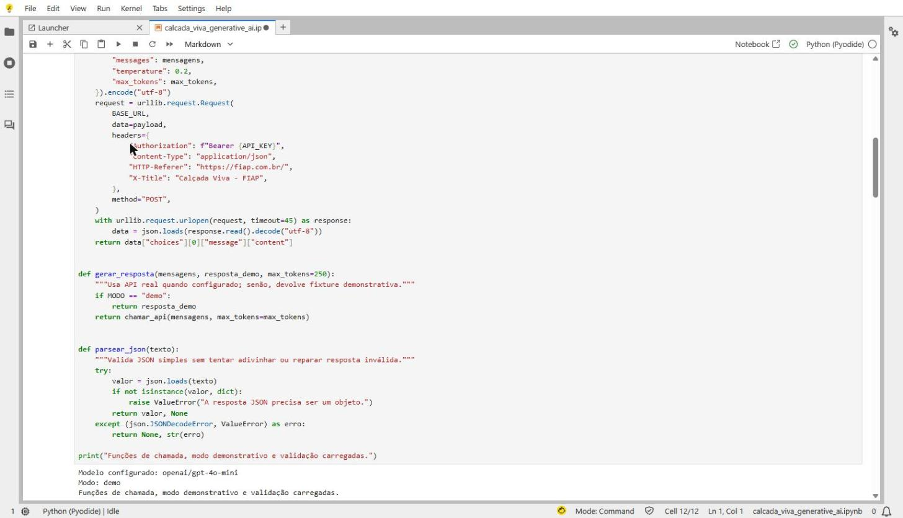
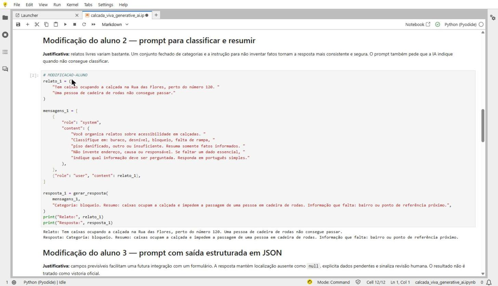
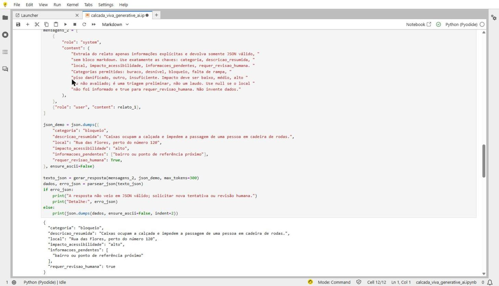
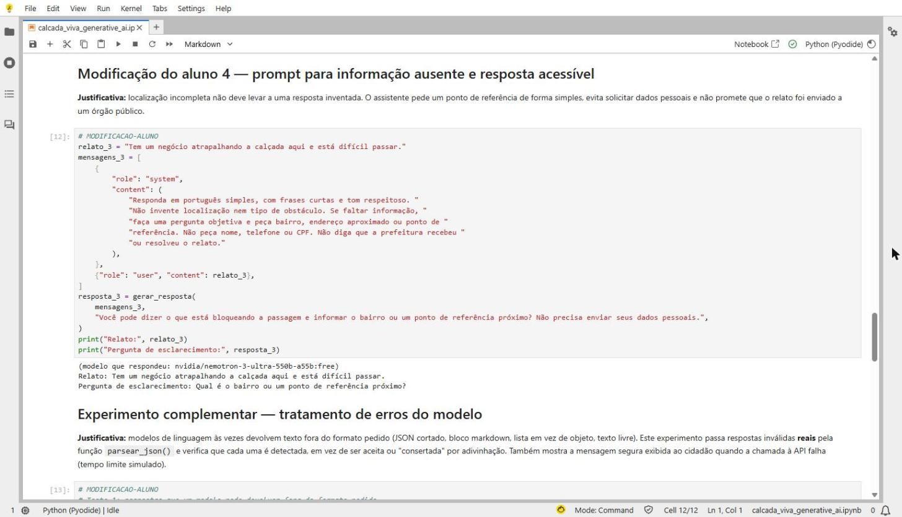
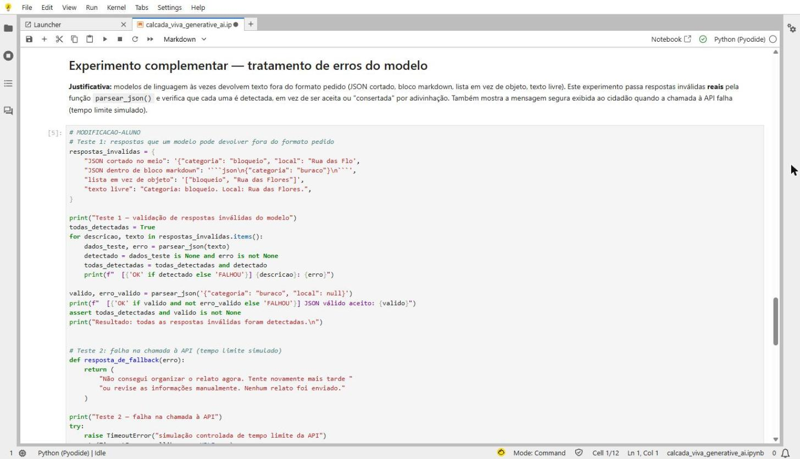
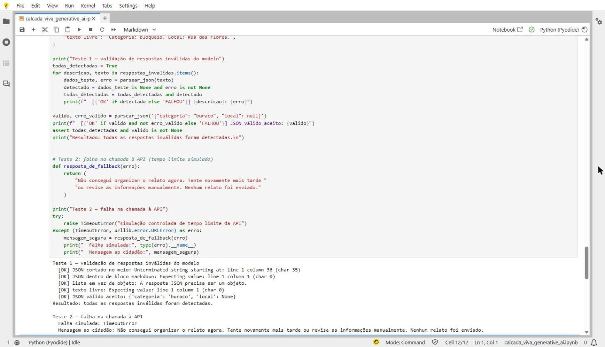

# Calçada Viva — IA Generativa para Engenharia

**GS – Generative AI for Engineering | Desafio CitizenTech | Engenharia de Software — FIAP**

**Integrantes:** Gustavo Felex (RM554242), Vinicius Issa Gois (RM553814), Gustavo Bonani (RM553493), Wesley Vieira (RM553496)

---

## 1. Problema escolhido

Calçadas com buracos, desníveis, falta de rampa ou obstáculos impedem a circulação de pessoas com deficiência, idosos e quem empurra carrinhos de bebê. Muitos cidadãos querem relatar o problema, mas escrevem relatos soltos e incompletos ("tem um negócio atrapalhando aqui"), sem tipo de barreira nem localização, o que dificulta o encaminhamento.

**Calçada Viva** é um helper com IA generativa que organiza esses relatos: classifica o tipo de barreira, resume apenas os fatos informados, devolve os dados em formato estruturado e pergunta o que está faltando. O cidadão revisa o resultado antes de compartilhá-lo.

## 2. Arquitetura da solução

```
 Cidadão (relato em texto livre)
            │
            ▼
 ┌──────────────────────────────┐
 │ Notebook Python (Jupyter)    │
 │  • prompts de sistema        │
 │  • gerar_resposta()          │──── modo "demo" ──► resposta fixa de exemplo
 │                              │
 │                              │──── modo "api" ───► OpenRouter (Chat Completions)
 │                              │                     modelo openai/gpt-4o-mini
 │  • parsear_json() valida     │
 │  • fallback em caso de falha │
 └──────────────────────────────┘
            │
            ▼
 Resultado para revisão humana
 (categoria, resumo, JSON, pergunta de esclarecimento)
```

| Componente | Descrição |
|---|---|
| `chamar_api()` | Envia a conversa ao endpoint `https://openrouter.ai/api/v1/chat/completions` usando só `urllib` (sem dependências externas). `temperature=0.2` para respostas consistentes. |
| `gerar_resposta()` | Escolhe entre o modo `demo` (sem custo e sem chave) e o modo `api` (chamada real ao modelo). |
| `parsear_json()` | Valida se a resposta é um objeto JSON; não tenta "consertar" respostas inválidas. |
| `resposta_de_fallback()` | Mensagem segura ao cidadão quando a API falha. Não inventa resultados e não apaga o relato. |

## 3. Modificações feitas no notebook

Todas as mudanças estão marcadas com `# MODIFICACAO-ALUNO` (código) ou `## Modificação do aluno` (markdown).

| # | Modificação | Motivo |
|---|---|---|
| 1 | **Troca do modelo via API** para `openai/gpt-4o-mini` no OpenRouter, configurável por `OPENROUTER_MODEL` | Modelo leve e barato, adequado para classificar e organizar textos curtos; configuração centralizada facilita comparar modelos. |
| 2 | **Prompt de classificação e resumo** com categorias fechadas | Relatos livres variam muito; categorias fixas e a regra de "não inventar fatos" deixam a saída consistente e segura. |
| 3 | **Prompt com saída estruturada em JSON** | Campos previsíveis permitem integração futura com formulários; `local` fica `null` se não informado e `requer_revisao_humana` é sempre `true`. |
| 4 | **Prompt para informação ausente** com linguagem acessível | Em vez de inventar a localização, o assistente pergunta de forma simples e não pede dados pessoais (nome, telefone, CPF). |
| 5 | **Experimento de tratamento de erros do modelo** | Passa 4 respostas inválidas reais (JSON cortado, JSON em bloco markdown, lista em vez de objeto, texto livre) pela função `parsear_json()` e confirma que todas são detectadas; também mostra a mensagem de contingência quando a API falha. |

## 4. Exemplos de prompts e saídas

> As saídas abaixo foram geradas no **modo demonstrativo** (respostas fixas de exemplo, sem chamar o modelo). Veja a seção 6 para executar com o modelo real.

### Classificação e resumo
**Prompt de sistema (trecho):** "Classifique em: buraco, desnível, bloqueio, falta de rampa, piso danificado, outro ou insuficiente. Resuma somente fatos informados. Não invente endereço, causa ou responsável."

**Relato:** "Tem caixas ocupando a calçada na Rua das Flores, perto do número 120. Uma pessoa de cadeira de rodas não consegue passar."

**Saída:**
```
Categoria: bloqueio. Resumo: caixas ocupam a calçada e impedem a passagem de uma pessoa
em cadeira de rodas. Informação que falta: bairro ou ponto de referência próximo.
```

### Saída estruturada em JSON
```json
{
  "categoria": "bloqueio",
  "descricao_resumida": "Caixas ocupam a calçada e impedem a passagem de uma pessoa em cadeira de rodas.",
  "local": "Rua das Flores, perto do número 120",
  "impacto_acessibilidade": "alto",
  "informacoes_pendentes": ["bairro ou ponto de referência próximo"],
  "requer_revisao_humana": true
}
```

### Informação ausente
**Relato:** "Tem um negócio atrapalhando a calçada aqui e está difícil passar."

**Saída:**
```
Você pode dizer o que está bloqueando a passagem e informar o bairro ou um ponto de
referência próximo? Não precisa enviar seus dados pessoais.
```

### Tratamento de erros do modelo
Este experimento não depende do modo demonstrativo: as respostas inválidas são testadas de verdade pela função de validação.
```
Teste 1 — validação de respostas inválidas do modelo
  [OK] JSON cortado no meio: Unterminated string starting at: line 1 column 36 (char 35)
  [OK] JSON dentro de bloco markdown: Expecting value: line 1 column 1 (char 0)
  [OK] lista em vez de objeto: A resposta JSON precisa ser um objeto.
  [OK] texto livre: Expecting value: line 1 column 1 (char 0)
  [OK] JSON válido aceito: {'categoria': 'buraco', 'local': None}
Resultado: todas as respostas inválidas foram detectadas.

Teste 2 — falha na chamada à API
  Falha simulada: TimeoutError
  Mensagem ao cidadão: Não consegui organizar o relato agora. Tente novamente mais tarde
  ou revise as informações manualmente. Nenhum relato foi enviado.
```

## 5. Evidências de execução

Prints do notebook executado no JupyterLab (kernel Python), com todas as células rodadas sem erro:

| Print | Conteúdo |
|---|---|
|  | Cabeçalho e Modificação 1 — configuração do modelo |
|  | Funções de chamada à API e saída da célula 1 |
|  | Modificação 2 — prompt de classificação e resumo |
|  | Modificação 3 — saída estruturada em JSON |
|  | Modificação 4 — pergunta por informação ausente |
|  | Experimento — tratamento de erros do modelo (código) |
|  | Experimento — tratamento de erros do modelo (saída dos testes) |

## 6. Como executar

1. Instale o ambiente: `pip install -r requirements.txt` (ou abra o notebook no Google Colab).
2. Abra `calcada_viva_generative_ai.ipynb` e execute todas as células. Por padrão, roda em **modo demonstrativo**, sem chave e sem custo.
3. Para chamar o modelo real:
   ```bash
   export OPENROUTER_API_KEY="sua-chave"   # nunca coloque a chave no notebook nem no GitHub
   export CALCADA_VIVA_MODE=api
   export OPENROUTER_MODEL=openai/gpt-4o-mini   # opcional
   ```
   No Colab, guarde a chave em **Secrets** e carregue com `userdata.get("OPENROUTER_API_KEY")`.
4. Reinicie o kernel e execute tudo. Chamadas reais podem gerar cobrança conforme o modelo e a conta.

## 7. Limitações

- As saídas registradas neste repositório vêm do modo demonstrativo; em modo `api`, as respostas podem variar a cada execução.
- A classificação é uma triagem preliminar, não um laudo técnico nem um protocolo oficial.
- O modelo pode classificar ou resumir de forma incorreta, ou devolver JSON inválido (nesse caso o notebook avisa e pede nova tentativa ou revisão humana).
- O funcionamento depende da disponibilidade da API do OpenRouter e da conexão.
- O protótipo não envia relatos à prefeitura nem a nenhum órgão público.

## 8. Aspectos éticos

- **Revisão humana obrigatória:** toda saída é marcada para revisão antes de ser compartilhada.
- **Sem invenção de dados:** os prompts proíbem inventar endereço, causa ou responsável; dados ausentes são perguntados ou ficam como `null`.
- **Privacidade:** o assistente não pede nome, telefone ou CPF, e o usuário é orientado a não incluir dados pessoais nos relatos.
- **Transparência:** o sistema não afirma que o relato foi recebido ou resolvido pela prefeitura e não substitui canais oficiais nem serviços de emergência.
- **Segurança da chave:** a chave da API fica em variável de ambiente e nunca é versionada.
- **Acessibilidade:** respostas em português simples, com frases curtas e tom respeitoso.
